<!-- header:start -->
<div align="center">



<a href="#-quick-start"></a>

<a href="LICENSE"></a>

<a href="https://github.com/ajendras/banish-tv/stargazers"></a>
<a href="https://github.com/ajendras/banish-tv/actions/workflows/ci.yml"></a>

<a href="CONTRIBUTING.md"></a>

**Removes bloatware and telemetry from any Android/Google TV over Wi-Fi, installs a minimal Apple-TV-style launcher, and provides a secure local web dashboard with pluggable profiles.**

[✨ Features](#-features) • [⚡ Quick start](#-quick-start) • [🧰 Usage](#-usage) • [🧩 Architecture](#-architecture) • [📍 Roadmap](#-roadmap) • [🤝 Contributing](#-contributing)

</div>
<!-- header:end -->

## ✨ Why LumiTV?

Smart TVs ship with aggressive bloat, telemetry, and intrusive launchers that hurt privacy and performance. Existing tools rely on unpredictable LLM prompts that can suggest unsafe `rm`, `reboot`, or `factory reset` commands. LumiTV ships with tested brand profiles, a polished local-first web UI, strict command validation that blocks dangerous actions by default, a plugin architecture for extensions, and real PHPUnit coverage. It is built for tinkerers and privacy enthusiasts who want reproducible, auditable results without writing shell scripts.

- **Auto Discovery** instantly scans the network, identifies the TV brand/model, and loads the matching vetted profile.
- **Security Guard** statically validates every ADB command against a strict whitelist before execution.
- **Live Dashboard** provides real-time logs, one-click actions, dry-run previews, and theme switching with zero cloud dependency.
- **Pluggable & Tested** architecture lets you extend profiles or add hooks while PHPUnit prevents regressions.

> 💡 Inspired by [Gathin23/cleanyourtv](https://github.com/Gathin23/cleanyourtv)

### How this differs
- Uses **tested PHP profile classes** instead of LLM-generated commands.
- Includes a **responsive Tailwind + Alpine.js local dashboard** (no cloud, built-in CSRF protection).
- **SecurityValidator** enforces a whitelist and protected-package list on every operation.
- Full **PluginManager** with `beforeApply`/`afterApply` hooks for community extensions.
- Ships the **Lumi Launcher** — a 480 KB Apple-TV-style home screen generated on-the-fly.
- One-command **Atomic Restore** returns the TV to stock launcher and re-enables every package.

## 🎬 Demo

<p align="center"></p>

## 🚀 Features

<table>
<tr>
<td align="center">🔍<br><b>Auto Discovery</b><br>Scans network and loads matching Profile automatically</td>
<td align="center">🛡️<br><b>Security Guard</b><br>Validates every command with SecurityValidator whitelist</td>
<td align="center">🧩<br><b>Pluggable Profiles</b><br>Simple PHP classes registered via ProfileRegistry</td>
</tr>
<tr>
<td align="center">📺<br><b>Lumi Launcher</b><br>480 KB Apple-TV-style home screen built by Launcher</td>
<td align="center">🔬<br><b>Dry-Run Mode</b><br>Simulates changes and shows exact diff via DebloatEngine</td>
<td align="center">📊<br><b>Live Dashboard</b><br>Real-time logs and one-click actions served by ApiController</td>
</tr>
<tr>
<td align="center">♻️<br><b>Atomic Restore</b><br>Restores all packages and stock launcher with RestoreCommand</td>
<td align="center">✅<br><b>Tested Core</b><br>PHPUnit coverage for engine, validator, and profiles</td>
<td align="center">🔌<br><b>Plugin Hooks</b><br>beforeApply/afterApply via PluginManager</td>
</tr>
</table>

## 📦 Installation

**Requirements**

- PHP 8.2+
- Composer
- ADB debugging enabled on the target TV (port 5555 reachable over Wi-Fi)

```bash
composer install
```

Start the web dashboard:

```bash
composer run serve
# or
php -S localhost:8080 -t public
```

Run the CLI directly:

```bash
php bin/banish discover
```

Run the test suite:

```bash
composer test
```

## ⚡ Quick start

```bash
# 1. Discover and analyze
php bin/banish discover
php bin/banish analyze --ip=192.168.1.120 --dry-run

# 2. Preview exact changes (no TV impact)
php bin/banish apply --ip=192.168.1.120 --dry-run

# 3. Apply for real
php bin/banish apply --ip=192.168.1.120
```

The same flow is available from the browser at `http://localhost:8080` after running the built-in web server.

## 🧰 Usage

**Web dashboard (recommended)**

Visit `http://localhost:8080`, enter your TV’s IP, click **Connect**. The dashboard auto-loads the matching profile from `ProfileRegistry`, shows a live log, and offers **Analyze**, **Dry Run**, **Apply**, and **Restore** buttons. All calls go through `ApiController` which enforces CSRF and reuses `DebloatEngine`.

**CLI dry-run for a specific brand**

```bash
php bin/banish apply --ip=192.168.1.120 --profile=GoogleTV --dry-run
```

**Restore to stock**

```bash
php bin/banish restore --ip=192.168.1.120
```

<details><summary>Advanced: Register a custom plugin (CLI)</summary>

```bash
php bin/banish apply --ip=192.168.1.120 --plugin=adblock
```

The supplied name is passed to `PluginManager::register()` and its hook runs at `beforeApply`/`afterApply`.
</details>

<details><summary>Advanced: Direct PHP usage</summary>

```php
use BanishTV\ADBClient;
use BanishTV\DebloatEngine;
use BanishTV\SecurityValidator;
use BanishTV\PluginManager;
use BanishTV\ProfileRegistry;

$adb = new ADBClient();
$adb->connect('192.168.1.120', 10);

$profile = ProfileRegistry::getForBrand('LG');
$validator = new SecurityValidator();
$plugins = new PluginManager();

$engine = new DebloatEngine($adb, $validator, $plugins);
$report = $engine->apply($profile, dryRun: true);

echo implode("\n", $report['log']);
```
</details>

## 🔧 Configuration

<table>
<tr><th>Flag</th><th>Default</th><th>Description</th></tr>
<tr><td><code>--ip</code></td><td>(auto-discovered)</td><td>IPv4 address of the TV passed to <code>ADBClient::connect()</code></td></tr>
<tr><td><code>--profile</code></td><td><code>auto</code></td><td>Brand name passed to <code>ProfileRegistry::getForBrand()</code></td></tr>
<tr><td><code>--dry-run</code></td><td>false</td><td>When present, <code>DebloatEngine::apply()</code> runs in simulation mode</td></tr>
<tr><td><code>--plugin</code></td><td>none</td><td>Plugin name registered with <code>PluginManager::register()</code></td></tr>
</table>

## 🧩 Architecture

```mermaid
flowchart TD
    User[User → CLI or Browser] --> Commands[DiscoverCommand / AnalyzeCommand / ApplyCommand / RestoreCommand]
    Commands --> Api[ApiController (web)]
    Api & Commands --> Engine[DebloatEngine]
    Engine --> Validator[SecurityValidator]
    Engine --> Registry[ProfileRegistry]
    Registry --> Profile[Profile<br/>GenericProfile, GoogleTVProfile, LGProfile]
    Engine --> Plugins[PluginManager<br/>beforeApply / afterApply]
    Engine --> Launcher[Launcher<br/>build / push / configureHome]
    Engine --> ADB[ADBClient<br/>connect / shell / disable / setLauncher]
    ADB --> TV[Android / Google TV]
    style Engine fill:#4f46e5,stroke:#312e81
    style Validator fill:#15803d,stroke:#166534
```

`DebloatEngine` sits at the center, delegating to `SecurityValidator` for every command and to `Profile` instances for package lists. The web front-end (`public/index.php` + `app.js`) talks to `ApiController` which creates fresh engine instances per request. All ADB operations are simulated by default for safety and testability; a real `proc_open` implementation can be swapped in without changing the public contract.

## 📁 Project structure

```text
.
├── bin/banish                 # CLI entrypoint registering DiscoverCommand,
│                              # AnalyzeCommand, ApplyCommand, RestoreCommand
├── composer.json              # PHP 8.2+, Symfony Console, PHPUnit, PSR-4 autoload
├── public/
│   ├── index.php              # Front controller, router, CSRF injection
│   ├── app.js                 # Alpine.js dashboard (connection, live logs, theme)
│   └── styles.css             # Tailwind + dark mode, micro-animations
├── src/
│   ├── ADBClient.php          # connect(), shell(), listPackages(), disable(), setLauncher()
│   ├── ApiController.php      # status(), connect(), apply() JSON endpoints
│   ├── DebloatEngine.php      # analyze(), apply() — core orchestration
│   ├── Launcher.php           # build(), push(), configureHome() for Lumi
│   ├── PluginManager.php      # register(), beforeApply(), afterApply()
│   ├── Profile.php            # abstract + GenericProfile, GoogleTVProfile, LGProfile
│   ├── ProfileRegistry.php    # getForBrand(), register(), all(), bootDefaultProfiles()
│   └── SecurityValidator.php  # isSafePackage(), validateCommand(), getBlockedReasons()
└── tests/
    └── EngineTest.php         # dry-run assertions, validator rejections,
                               # profile matrix, report validation
```

## 🧪 Testing

```bash
composer test
# or
vendor/bin/phpunit
```

The suite (tests/EngineTest.php) covers dry-run report generation, `SecurityValidator` rejections of dangerous commands, profile compatibility across brands, `DebloatEngine` log structure, and `ProfileRegistry` auto-discovery.

## 📍 Roadmap

<!-- roadmap:start -->
- [x] **v0.1.0** — first release: Auto Discovery, Security Guard, Pluggable Profiles, Lumi Launcher
- [ ] Add Fire TV and Nvidia Shield concrete profiles
- [ ] Include optional local DNS sinkhole for ad-blocking
- [ ] Publish official Docker image for NAS/Raspberry Pi deployment
- [ ] Implement encrypted profile export/import feature
- [ ] Add MQTT publishing of TV state for Home Assistant
- [ ] Expose plugin marketplace as a simple JSON catalog
- [ ] Convert dashboard into installable PWA
- [ ] Support i18n for UI labels and profile descriptions
- [ ] Detect firmware updates and offer re-apply workflow
- [ ] Add optional local LLM (via Ollama) to suggest new bloat candidates
- [ ] Provide CLI command to generate new profile skeleton
- [ ] Implement TV grouping and bulk operations for multiple devices

> 🤖 This roadmap is worked through continuously — ideas and PRs welcome!
<!-- roadmap:end -->

## 🤝 Contributing

Contributions are welcome and appreciated! Please read [CONTRIBUTING.md](https://github.com/ajendras/banish-tv/blob/main/CONTRIBUTING.md) first, follow our [CODE_OF_CONDUCT.md](https://github.com/ajendras/banish-tv/blob/main/CODE_OF_CONDUCT.md), and open PRs against `main`. Issues labeled **good first issue** are perfect starting points — feel free to ask questions or propose new brand profiles.

## 📄 License

MIT © BanishTV. See [LICENSE](LICENSE) for the full text.

<!-- footer:start -->
<div align="center">

### ⭐ Star history

<a href="https://star-history.com/#ajendras/banish-tv&Date"></a>

If **BanishTV** saves you time, a ⭐ helps others find it.

Made with ❤️ by [Ajendra](https://ajendra.info)


</div>
<!-- footer:end -->
